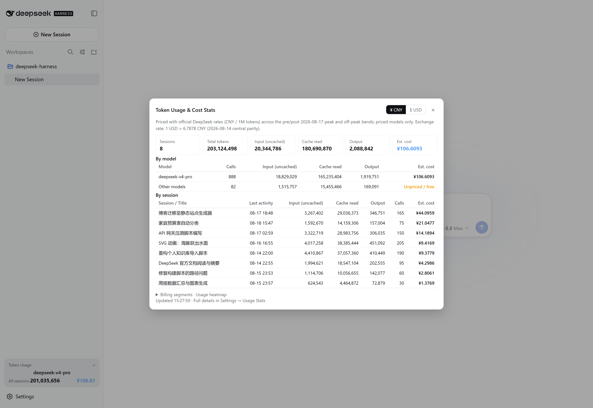
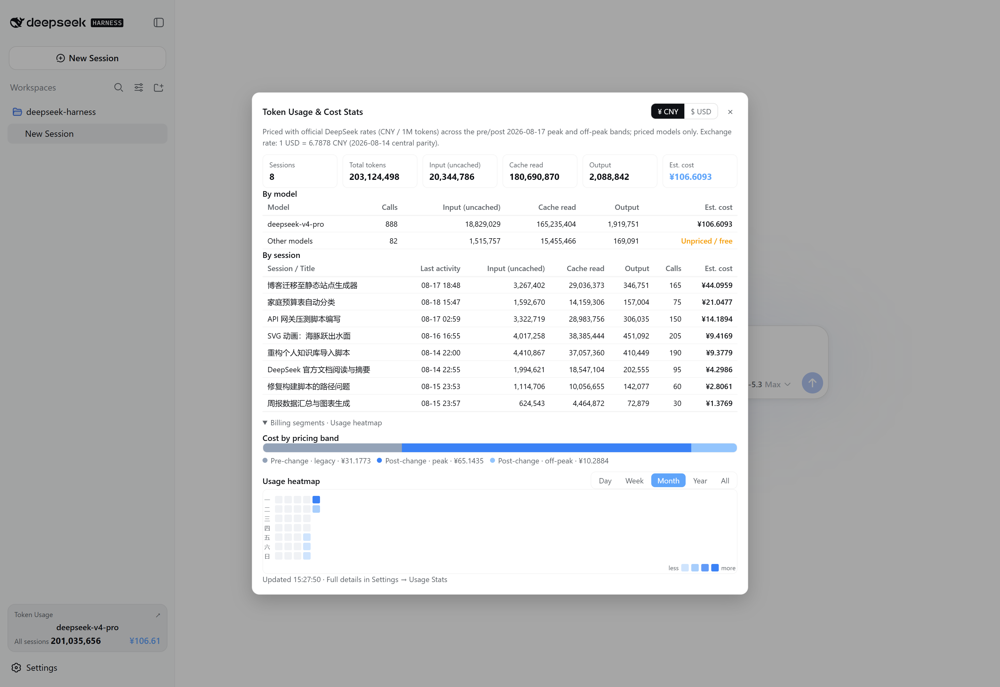
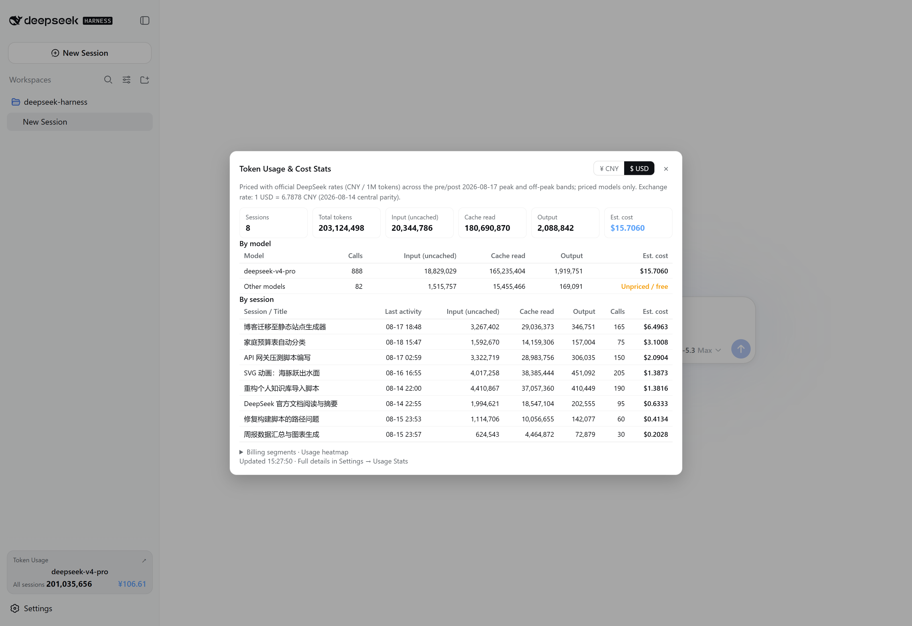
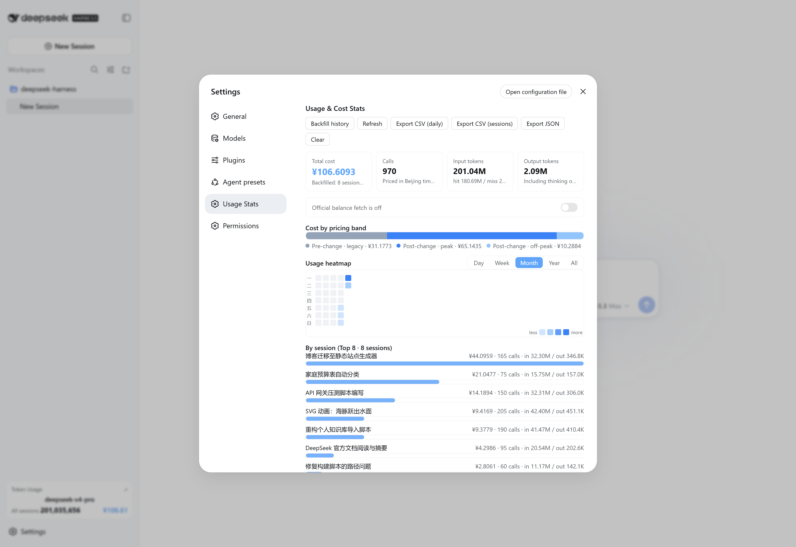

# dsh-usage-billing · Usage & Cost Statistics for DeepSeek Harness

[](https://beancookie.github.io/awesome-dsh-plugin) [](https://awesome-dsh-plugin.com)

[中文](README.md) | English

A **build-free** dual-face plugin for DeepSeek Harness: tracks every DeepSeek model call across all sessions, bills them by official pricing, and provides charted usage panels on the main UI and the settings page.

> Billing: legacy prices before 2026-08-17 00:00 (Beijing time); peak/off-peak pricing after that (peak = **weekdays** 9:00–12:00 & 14:00–18:00 (effective 2026-08-23; before that weekends also counted as peak); off-peak is half the peak rate; from 9/10 12:00 the flash series reprices again (off-peak hit 0.02 / miss 1 / out 4, peak ×2, pro unchanged; V4 Pro continues after 9/14 at unchanged pro rates (a routing toggle is kept for a future official change; currently off))). **Public holidays and make-up workdays bill off-peak all day** (the 2026 State Council schedule is built in; extra dates can be added in settings). Price table at the bottom.

## Features

- **Automatic tracking**: listens to `llm/stream` and records every model call (input / output / cache hit / cache miss tokens)
- **Historical backfill**: on first start, scans local session logs to rebuild historical usage and cost, with session titles
- **Tiered billing**: each call falls into "pre-change · legacy", "post-change · peak", or "post-change · off-peak" by Beijing time (since 2026-08-23, peak applies on weekdays only; before that weekends also counted as peak; **public holidays and make-up workdays are off-peak all day** — the holiday list is editable in settings, so the 2027 schedule can be added once published)
- **Budget alert notifications**: desktop toast when crossing 80%/100% thresholds (once per threshold per day), plus progress bars (orange near 80%, red when over)
- **Configurable pricing**: price table, peak hours, boundary date, and USD exchange rate are all editable (changes apply to subsequent calls only), with one-click reset to defaults
- **Third-party model pricing**: official list prices for GLM / Grok / Hunyuan HY4 are built in (substring match, CNY or USD with conversion), so those calls no longer cost ¥0; rules are editable in settings. Kimi's official price table is not machine-readable yet, so add it manually.
- **Export**: one-click CSV (daily / per-session, filename includes the date range) or JSON export for accounting
- **Official balance**: auto-detects the configured DeepSeek API key and fetches the official account balance (total / topped up / granted), refreshing every 10 minutes; silently skipped when no key is configured
- **Balance runway**: estimates days left and the projected exhaust date from the 7-day average spend
- **Alert history**: recent budget alerts listed in the settings page
- **Daily trend chart**: 30-day daily cost bars in the settings page
- **More robust storage**: writes keep a .tmp copy and auto-recover from it when the main file is corrupt; multi-instance heartbeat detection warns about concurrent writes
- **Main UI**:
  - A "Token Usage" card at the sidebar foot (current model + this-session tokens/cost, thousands-separated, plus a **7-day spend sparkline** with per-day hover) → opens a centered "Token Usage & Cost Stats" dialog (¥/USD currency toggle, overview cards, by-model / by-session tables with zebra striping, budget progress, official balance, billing-segment ratio, usage heatmap)
  - A persistent line under the composer showing the **current session** usage: a ring (daily budget, amber ≥80%, red ≥100%) plus cost/calls/tokens — **click to open a detail panel** (session cost & today total, billing-band ratio bar, calls/in/cache-hit-rate/out rows, per-band cost, per-model split, daily budget; Esc or outside click dismisses) — interaction and styling match the official ContextMeter
- **Settings → Usage Stats**: full details (stat cards, budget progress, segment ratio, day/week/month/year/all heatmap with instant hover tooltips, per-session Top 8 (click to open the session), per-model, recent calls, backfill/clear/export, pricing & budget editor)
- **Dynamic tool `usage_billing`**: the model can query statistics directly ("how much have I spent?" / "today?" — today/month/all scopes; `group` ranks spend by band/model/session/day, `session` filters by session id or title and returns that session's band/model breakdown, `limit` caps the rows)
- **Persistence**: data is written to `.dsh-usage-billing.json` under the write-policy root; survives restarts (before v0.5.4: `.dsh-usage-stats.json`, auto-migrated on upgrade)
- **Bilingual UI**: all panel copy follows the app language setting (Chinese / English) and switches instantly

## Screenshots

> The screenshots below use fictional demo data.

**Stats dialog · overview** (opened from the sidebar Token Usage card)



**Stats dialog · charts** (billing-segment ratio + usage heatmap, with ¥/USD toggle)



**USD mode** (one-click toggle in the dialog header, exchange-rate converted)



**Settings · Usage Stats**



## Install

### Option A: one-line npm install (recommended, prebuilt)

```powershell
dsh plugin --profile web add dsh-usage-billing
```

npm package: https://www.npmjs.com/package/dsh-usage-billing

The package auto-mounts at startup through its `dsh.bundle.patch` (`cordis.patch.yml`) — no other configuration needed.

> ⚠ Do not patch official bundles (e.g. `@deepseek-ai/dsh-web-app/cordis.patch.yml`) directly,
> and do not place the plugin inside the `npm-cache\_npx` cache (npm reify rebuilds it and leaves dangling links).

> A local path works too: `dsh plugin --profile web add <repo path>`.

### Option B: user patch layer (without touching the profile)

Add the content of the repo-root `cordis.patch.yml` to:

```
%USERPROFILE%\.dsh\cordis.patch.yml
```

```yaml
- insert:
    - id: usage-billing
      name: 'dsh-usage-billing'
```

## Data & billing

| Data | Location / notes |
| --- | --- |
| Stats file | `.dsh-usage-billing.json` under the write-policy root (usually the user home) |
| Billing zone | Beijing time; rate-change boundary 2026-08-17 00:00 |
| Unit | CNY per million tokens |

Price table (CNY per million tokens):

| Period | Model | Cache hit | Cache miss | Output |
| --- | --- | --- | --- | --- |
| Before 8/17 | flash | 0.02 | 1 | 2 |
| Before 8/17 | v4-pro | 0.025 | 3 | 6 |
| After 8/17 · off-peak | flash | 0.05 | 1.5 | 4.5 |
| After 8/17 · peak | flash | 0.10 | 3.0 | 9.0 |
| After 8/17 · off-peak | v4-pro | 0.15 | 4.5 | 13.5 |
| After 8/17 · peak | v4-pro | 0.30 | 9.0 | 27.0 |
| Since 9/10 12:00 · off-peak | flash | 0.02 | 1 | 4 |
| Since 9/10 12:00 · peak | flash | 0.04 | 2 | 8 |

> Models are classified by name substring: names containing `flash` (the new `deepseek-flash` plus legacy `deepseek-v4-flash` / `deepseek-v4-flash-vision-exp` — retired names are served by V4.1-Flash at Flash rates) are billed at flash rates, `pro` at pro rates, others as "unpriced / free". **A model matching a custom rule is billed by that rule and lands in "other"** (so `glm-5.3-flash` is not mistaken for DeepSeek flash).

Reference: [DeepSeek API pricing](https://api-docs.deepseek.com/zh-cn/quick_start/pricing)

> Holiday billing: the **2026** ([State Council notice](https://www.gov.cn/zhengce/zhengceku/202511/content_7047091.htm)) and **2027** ([notice](https://www.gov.cn/zhengce/content/202611/content_7085101.htm)) schedules — holidays plus make-up workdays — are built in; a matching date bills off-peak all day. The "Off-peak dates" editor in settings accepts one `YYYY-MM-DD` per line for future years.

Built-in third-party prices (CNY or USD per 1M tokens, read from each vendor's rendered pricing page in 2026-11; 71 rules, editable in settings):

| Vendor | Built-in matches (excerpt) | Currency | Notes | Source |
| --- | --- | --- | --- | --- |
| Zhipu GLM | `glm-5.3-flash`, `glm-5.3`, `glm-5.2` | CNY | hit 0.23–2 / input 0.8–8 / output 2.8–28 | [Zhipu pricing](https://docs.bigmodel.cn/cn/guide/start/pricing) |
| xAI Grok | `grok-4.7`, `grok-4.6` | USD | <200k context standard rate | [xAI pricing](https://docs.x.ai/developers/pricing) |
| Tencent Hunyuan | `hy4-preview`, `hy4` | CNY | list price (a 50% promo runs until 2026-12-31) | [Tencent TokenHub](https://cloud.tencent.com/document/product/1823/130055) |
| OpenAI | `gpt-6-astra`, `gpt-6.1-*`, `gpt-6-*`, `gpt-5.6-*`, `gpt-5.5*`, `gpt-5.4*`, `gpt-5.2*`, `gpt-5.1`, `gpt-5*`, `gpt-4.1*`, `gpt-4o*`, `o3` | USD | Standard, short context (≤272K) | [OpenAI pricing](https://developers.openai.com/api/docs/pricing) |
| Anthropic Claude | `claude-opus-5-5`, `claude-opus-5`, `claude-opus-4-*`, `claude-sonnet-5-*`, `claude-sonnet-4-*`, `claude-haiku-5-5`, `claude-haiku-4-5` | USD | standard rates (model ids use hyphens) | [Claude pricing](https://platform.claude.com/docs/en/about-claude/pricing) |
| Moonshot Kimi | `kimi-k3.1-pro-highspeed`, `kimi-k3.1-pro`, `kimi-k3`, `kimi-k2.7-code*`, `kimi-k2.6` | CNY | highspeed costs more and is listed first | [Kimi pricing](https://platform.kimi.com/docs/pricing/chat) |
| Google Gemini | `gemini-4-argon`, `gemini-3.8-flash`, `gemini-3.6-flash`, `gemini-3.5-flash-lite`, `gemini-3.1-flash-lite`, `gemini-3.1-pro` | USD | Paid-tier standard rates; some rise in 2026-12 / 2027-01 | [Gemini pricing](https://ai.google.dev/gemini-api/docs/pricing) |
| ByteDance Doubao | `doubao-seed-evolving`, `doubao-seed-2.1-*`, `doubao-seed-2.0-*`, `doubao-seed-character`, `doubao-seed-translation` | CNY | Volcengine Ark standard rates; long context uses the [0,32K] tier | [Volcengine pricing](https://www.volcengine.com/docs/82379/1099320) |

> Every price was read after rendering the vendor's own pricing page (the Kimi and Gemini tables are script-rendered, so static HTML has no numbers). Prices change: the built-in table is only a default and stays editable, and `customModelsSource` tracks whether a config still follows the built-ins or was customised.

## Structure

```
.
├── lib/
│   ├── index.js     # Host half: llm/stream tracking, billing, backfill, persistence, /usage-billing route, usage_billing tool
│   └── client.js    # Client half: main-UI entries + settings panel (window.__ModuleLoader__ bundle, build-free)
├── cordis.patch.yml # Bundle patch declaring the mount row (dsh.bundle.patch mechanism)
├── package.json     # exports ("." / "./client" / "./cordis.patch.yml") + dsh.client / dsh.bundle declarations
├── PUBLISH.md       # Publishing guide (GitHub / npm / install)
├── LICENSE
└── README.md
```

## FAQ

- **Doubled stats**: older versions rebuilt without clearing first; since v0.2.0 a `schemaVersion` migration marker triggers a single clean rebuild on restart.
- **Panel not showing**: the client bundle is discovered by the deployment's `clientModules` service; restart the app and refresh the page after first install.
- **Two instances at once**: the stats file is a shared resource and concurrent writes overwrite each other — keep a single instance.
- **Overwritten by upgrades**: redeploying the app directory overwrites built-in patch lines and package files; re-run the install step.
- **dsh version compatibility**: verified against 0.1.2-alpha.1 through **0.2.2-rc.1** (since 0.1.6 `sessions.open` is gone; session navigation automatically uses `uiWorkspace.openSession` with a fallback for older runtimes; since 0.2.0 the runtime enforces peerDependencies, and this plugin declares a compatible range). Per-version findings and a reproducible checklist live in [`COMPAT.md`](COMPAT.md); the roadmap is in [`BACKLOG.md`](BACKLOG.md).

## License

MIT
