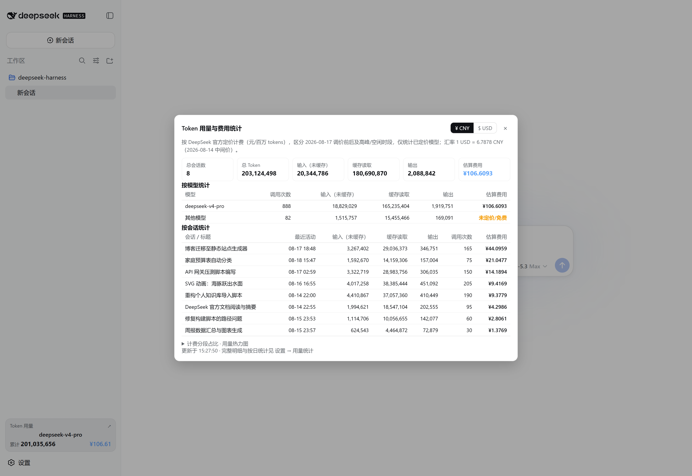
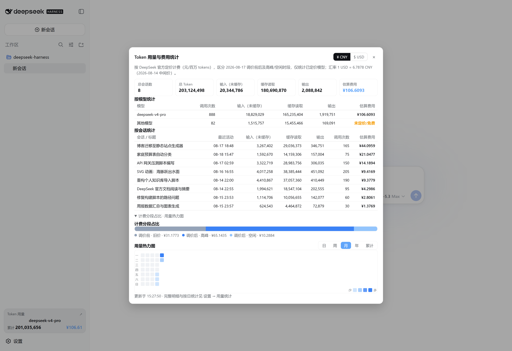
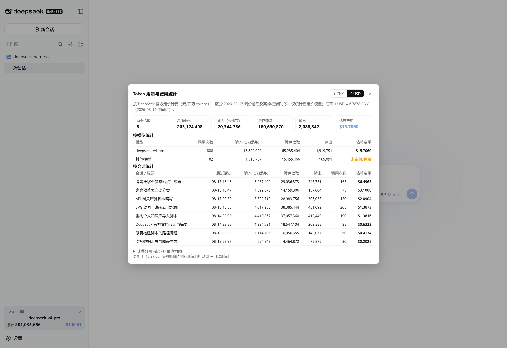
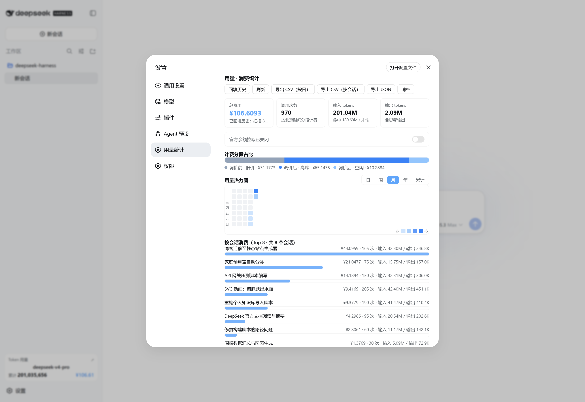

# dsh-usage-billing · DeepSeek 用量与消费统计插件

[](https://beancookie.github.io/awesome-dsh-plugin) [](https://awesome-dsh-plugin.com)

中文 | [English](README.en.md)

针对 DeepSeek Harness 的**免构建**双面插件：自动统计本机所有会话的 DeepSeek 模型调用，按官方定价分段计费，并在主界面与设置页提供图表化的用量面板。

> 计费口径：2026-08-17 00:00（北京时间）前旧价；之后峰谷定价（高峰为**工作日** 9:00–12:00、14:00–18:00（2026-08-23 起生效，此前周末同样计高峰），空闲价为高峰价的一半；9/10 12:00 起 flash 系列再次调价（空闲 hit 0.02 / miss 1 / out 4，高峰 ×2，pro 不变；V4 Pro 官方已确认 9/14 后继续提供服务、计费方式不变（仍按 pro 价；插件保留路由开关供将来官方恢复路由时开启，当前关闭）））。**法定节假日与调休上班的周末全天空闲计费**（内置 2026 年国务院放假安排，可在设置中自行增补）。价格表见文末。

## 功能

- **全自动统计**：监听 `llm/stream`，所有会话的每次模型调用都会被记录（输入/输出/缓存命中/未命中 tokens）
- **历史回填**：首次启动自动扫描本机会话日志，重建历史用量与消费，并附会话标题
- **分段计费**：按北京时间自动归入「调价前旧价 / 调价后高峰 / 调价后空闲」三段（2026-08-23 起高峰仅限工作日，周末全天空闲；此前周末同样计高峰；**法定节假日与调休上班日全天空闲**，节假日名单可在设置页编辑，2027 年安排公布后可自行增补）
- **预算告警通知**：跨 80%/100% 阈值时桌面 toast 主动提醒（每日每档一次），进度条临近变橙、超支变红
- **月度预测与突增提醒**：统计弹窗与设置页常显「本月已用 · **预计月底** · 近 7 天日均」（按本月已过天数线性外推，无需设置预算）；今日花费达到近 7 天日均 3 倍（且 ≥¥1）时弹一次「花费突增」提醒（每天最多一次）
- **定价可配置**：价格表、高峰时段、调价边界日期、美元汇率均可编辑（改动只对后续调用生效），一键恢复默认
- **第三方模型计价**：内置 GLM / Grok / 混元 HY4 的官方标准价（可按模型名子串匹配、CNY 或 USD，USD 按汇率折算），这些调用不再记为 ¥0；设置页可增删改规则。Kimi 的官方价表暂未提供可抓取的数字，需要手动添加。
- **数据导出**：一键导出 CSV（按日 / 按会话，文件名含日期范围）或 JSON，便于对账
- **官方余额拉取**：自动检测已配置的 DeepSeek API Key，拉取官方账户余额（总余额 / 充值 / 赠金），每 10 分钟自动刷新，未配置 Key 时静默跳过
- **余额续航预估**：按近 7 天日均花费估算余额可用天数与预计耗尽日期
- **余额低阈值提醒**：余额低于阈值（默认 20，可留空关闭）时提醒一次，跌破阈值一半再提醒一次（每天最多两次）
- **告警历史**：设置页展示最近预算告警记录
- **日趋势图**：设置页近 30 天每日费用柱状图
- **统计更稳健**：写入带 temp 副本，主文件损坏时自动恢复；双实例心跳检测告警
- **主界面**：
  - 侧边栏底部「Token 用量」卡片（当前模型 + 本会话 tokens/费用，千分位显示，底部**近 7 天花费迷你趋势**，悬停看每天金额）→ 点击弹出居中「Token 用量与费用统计」弹窗（¥/USD 币种切换、总览卡片、按模型/按会话表格（斑马纹、表头点击排序）、预算进度、官方余额、分段占比、用量热力图）
  - 输入框下方常驻一行**当前会话**的用量：环形进度（今日预算，≥80% 变橙、≥100% 变红）+ 花费/调用/tokens，**点击弹出详情面板**（本会话累计花费与**本会话今日**花费、按计费时段着色的占比条、调用/输入/缓存命中率/输出明细、时段花费、模型分布、今日预算进度；悬停「本会话今日」显示全部会话今日合计；Esc 或点击面板外关闭）——交互与样式对齐官方 ContextMeter
- **设置页 → 用量统计**：完整明细（统计卡片、预算进度、分段占比、日/周/月/年/累计热力图（悬停即时显示 token 与金额）、按会话 Top 8（可点击打开对应会话）、按模型、最近调用、回填/清空/导出、计费与预算设置）
- **动态工具 `usage_billing`**：模型可直接查询统计（“现在用了多少钱？”“今天呢？”——支持 today/month/all 范围；`group` 可按 band/model/session/day 给出花费排行，`session` 可按会话 id 或标题筛选并返回该会话的时段/模型分布，`limit` 控制条数）
- **持久化**：数据写入写策略根目录 `.dsh-usage-billing.json`，重启不丢（v0.5.4 前为 `.dsh-usage-stats.json`，升级后自动迁移）
- **中英双语**：所有界面文案跟随应用语言设置即时切换（中文 / English）

## 界面预览

> 以下截图基于虚构演示数据。

**统计弹窗 · 总览**（主界面侧边栏卡片点开）



**统计弹窗 · 图表区**（分段占比 + 用量热力图，支持 ¥/USD 切换）



**美元模式**（弹窗右上角一键切换，汇率换算）



**设置页 · 用量统计**



## 安装

### 方式 A：npm 一键安装（推荐，预构建）

```powershell
dsh plugin --profile web add dsh-usage-billing
```

npm 包：https://www.npmjs.com/package/dsh-usage-billing

应用启动时通过本包的 `dsh.bundle.patch`（`cordis.patch.yml`）自动挂载，无需任何其他配置。

> ⚠ 不要直接修改官方 bundle（如 `@deepseek-ai/dsh-web-app/cordis.patch.yml`），
> 也不要把插件放进 `npm-cache\_npx` 缓存（npm reify 会随时重建并留下悬空链接）。

> 本地路径形式同样支持：`dsh plugin --profile web add <本仓库路径>`。

> 📌 **link:/本地 link 开发安装的机器绑定说明**：`@deepseek-ai/dsh-tools` 由宿主 dsh
> 提供（见 `peerDependencies`），npm 上暂无匹配版本，因此本地 link 安装时它解析自
> 宿主侧。若插件的 `node_modules` 中没有对应链接，可在插件目录建一个指向 dsh
> 农场的 junction（农场由当前活跃引擎自动维护，跟随引擎版本）：
>
> ```powershell
> New-Item -ItemType Junction -Path "node_modules\@deepseek-ai\dsh-tools" `
>   -Target "$env:USERPROFILE\.dsh\profiles\node_modules\@deepseek-ai\dsh-tools"
> ```
>
> 该 junction 与本机 `~/.dsh` 绑定，**换机器需重建**（`dsh plugin add` 本地路径方式
> 不受影响）；npm 方式安装（方式 A）完全无此问题。

### 方式 B：用户级补丁（不动 profile）

把本仓库根目录的 `cordis.patch.yml` 内容加入：

```
%USERPROFILE%\.dsh\cordis.patch.yml
```

```yaml
- insert:
    - id: usage-billing
      name: 'dsh-usage-billing'
```

> 内置进打包部署（开箱即用）的完整方案见 `PUBLISH.md`。

## 数据与口径

| 数据 | 位置 / 说明 |
| --- | --- |
| 统计文件 | 写策略根目录下 `.dsh-usage-billing.json`（通常为用户主目录） |
| 计费时段 | 北京时间；调价边界 2026-08-17 00:00 |
| 计费单位 | 元 / 百万 tokens |

价格表（元 / 百万 tokens）：

| 时段 | 模型 | 命中 | 未命中 | 输出 |
| --- | --- | --- | --- | --- |
| 8/17 前 | flash | 0.02 | 1 | 2 |
| 8/17 前 | v4-pro | 0.025 | 3 | 6 |
| 8/17 后·空闲 | flash | 0.05 | 1.5 | 4.5 |
| 8/17 后·高峰 | flash | 0.10 | 3.0 | 9.0 |
| 8/17 后·空闲 | v4-pro | 0.15 | 4.5 | 13.5 |
| 8/17 后·高峰 | v4-pro | 0.30 | 9.0 | 27.0 |
| 9/10 12:00 后·空闲 | flash | 0.02 | 1 | 4 |
| 9/10 12:00 后·高峰 | flash | 0.04 | 2 | 8 |

> 模型按名称子串归类计价：名字含 `flash`（含新名 `deepseek-flash` 及旧名 `deepseek-v4-flash`、`deepseek-v4-flash-vision-exp`——旧名已下线、由 V4.1-Flash 服务并同价计费）按 flash 档，含 `pro` 按 pro 档，其余归入「未定价/免费」；**命中自定义价目的模型优先按自定义价计费并归入「其他模型」**（因此 `glm-5.3-flash` 不会被误判成 DeepSeek flash 档）。

> 节假日计费：内置 **2026 年**（[国办发明电〔2025〕7号](https://www.gov.cn/zhengce/zhengceku/202511/content_7047091.htm)）与 **2027 年**（[国办发明电〔2026〕10号](https://www.gov.cn/zhengce/content/202611/content_7085101.htm)）国务院放假安排，含放假日期与调休上班日，命中即全天空闲；设置页「非高峰日」可编辑（每行一个 `YYYY-MM-DD`），后续年份公布后可自行增补。

内置第三方模型价目（元或美元 / 百万 tokens，2026-11 渲染官方定价页核对；共 71 条，设置页可增删改）：

| 厂商 | 内置匹配（节选） | 货币 | 说明 | 官方来源 |
| --- | --- | --- | --- | --- |
| 智谱 GLM | `glm-5.3-flash`、`glm-5.3`、`glm-5.2` | CNY | 命中 0.23–2 / 输入 0.8–8 / 输出 2.8–28 | [智谱定价](https://docs.bigmodel.cn/cn/guide/start/pricing) |
| xAI Grok | `grok-4.7`、`grok-4.6` | USD | <200k 上下文标准价 | [xAI Pricing](https://docs.x.ai/developers/pricing) |
| 腾讯混元 | `hy4-preview`、`hy4` | CNY | 目录价（官方五折活动期内实际更低） | [腾讯 TokenHub](https://cloud.tencent.com/document/product/1823/130055) |
| OpenAI | `gpt-6-astra`、`gpt-6.1-*`、`gpt-6-*`、`gpt-5.6-*`、`gpt-5.5*`、`gpt-5.4*`、`gpt-5.2*`、`gpt-5.1`、`gpt-5*`、`gpt-4.1*`、`gpt-4o*`、`o3` | USD | Standard、短上下文（≤272K） | [OpenAI Pricing](https://developers.openai.com/api/docs/pricing) |
| Anthropic Claude | `claude-opus-5-5`、`claude-opus-5`、`claude-opus-4-*`、`claude-sonnet-5-*`、`claude-sonnet-4-*`、`claude-haiku-5-5`、`claude-haiku-4-5` | USD | 标准价（模型 ID 用连字符） | [Claude Pricing](https://platform.claude.com/docs/en/about-claude/pricing) |
| Moonshot Kimi | `kimi-k3.1-pro-highspeed`、`kimi-k3.1-pro`、`kimi-k3`、`kimi-k2.7-code*`、`kimi-k2.6` | CNY | highspeed 更贵，规则已排前 | [Kimi 定价](https://platform.kimi.com/docs/pricing/chat) |
| Google Gemini | `gemini-4-argon`、`gemini-3.8-flash`、`gemini-3.6-flash`、`gemini-3.5-flash-lite`、`gemini-3.1-flash-lite`、`gemini-3.1-pro` | USD | Paid 层标准价；部分价格 2026-12/2027-01 起上调 | [Gemini Pricing](https://ai.google.dev/gemini-api/docs/pricing) |
| 字节豆包 | `doubao-seed-evolving`、`doubao-seed-2.1-*`、`doubao-seed-2.0-*`、`doubao-seed-character`、`doubao-seed-translation` | CNY | 火山方舟在线推理标准价；长上下文取 [0,32K] 档 | [火山方舟价格](https://www.volcengine.com/docs/82379/1099320) |

> 以上价格均从各厂商官方定价页**渲染后**读取（Kimi/Gemini 的表格是脚本渲染，静态 HTML 抓不到）。价格会调整，内置表只作为默认值，随时可在设置页修改；`customModelsSource` 会区分「沿用内置」与「用户自定义」，前者随插件升级自动更新。

参考：[DeepSeek API 定价](https://api-docs.deepseek.com/zh-cn/quick_start/pricing)

## 目录结构

```
.
├── lib/
│   ├── index.js     # Host 半体：llm/stream 监听、计费、回填、持久化、/usage-billing 路由、usage_billing 工具
│   └── client.js    # Client 半体：主界面入口 + 设置页面板（window.__ModuleLoader__ 打包格式，免构建）
├── assets/
│   └── screenshots/ # 界面预览截图（虚构演示数据，中/英）
├── cordis.patch.yml # bundle 补丁：声明挂载行（dsh.bundle.patch 机制）
├── package.json     # exports（"." / "./client" / "./cordis.patch.yml"）+ dsh.client / dsh.bundle 声明
├── PUBLISH.md       # 发布指南（GitHub / npm / 用户安装）
├── LICENSE
└── README.md
```

## 常见问题

- **统计翻倍**：老版本自动回填未先清空导致；v0.2.0 起用 `schemaVersion` 迁移标记，重启自动单次重建修正。
- **面板不显示**：客户端 bundle 由部署的 `clientModules` 服务发现；首次安装后需重启应用并刷新页面。
- **两个实例同时运行**：统计文件是共享资源，多实例同时写会互相覆盖，请保持单实例。
- **升级被覆盖**：部署目录升级会覆盖内置补丁行与包文件，重跑一遍安装步骤即可。
- **dsh 版本兼容**：0.1.2-alpha.1 ~ **0.2.2-rc.1** 实测通过（0.1.6 起 `sessions.open` 被移除，会话导航自动改走 `uiWorkspace.openSession`，旧运行时自动回退；0.2.0 起运行时强制校验 peerDependencies，本插件已声明兼容区间）。逐版本核查结论与可复现方法见 [`COMPAT.md`](COMPAT.md)，后续计划见 [`BACKLOG.md`](BACKLOG.md)。

## License

MIT
